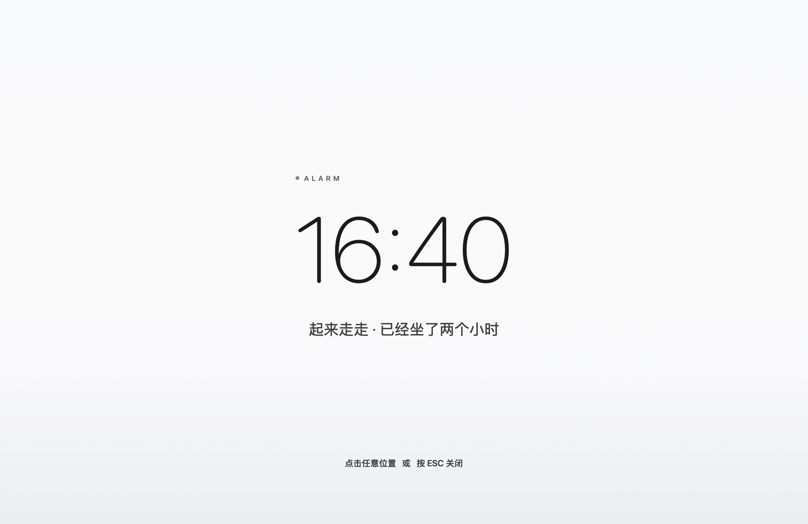
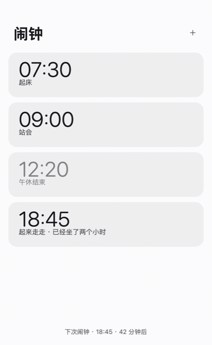
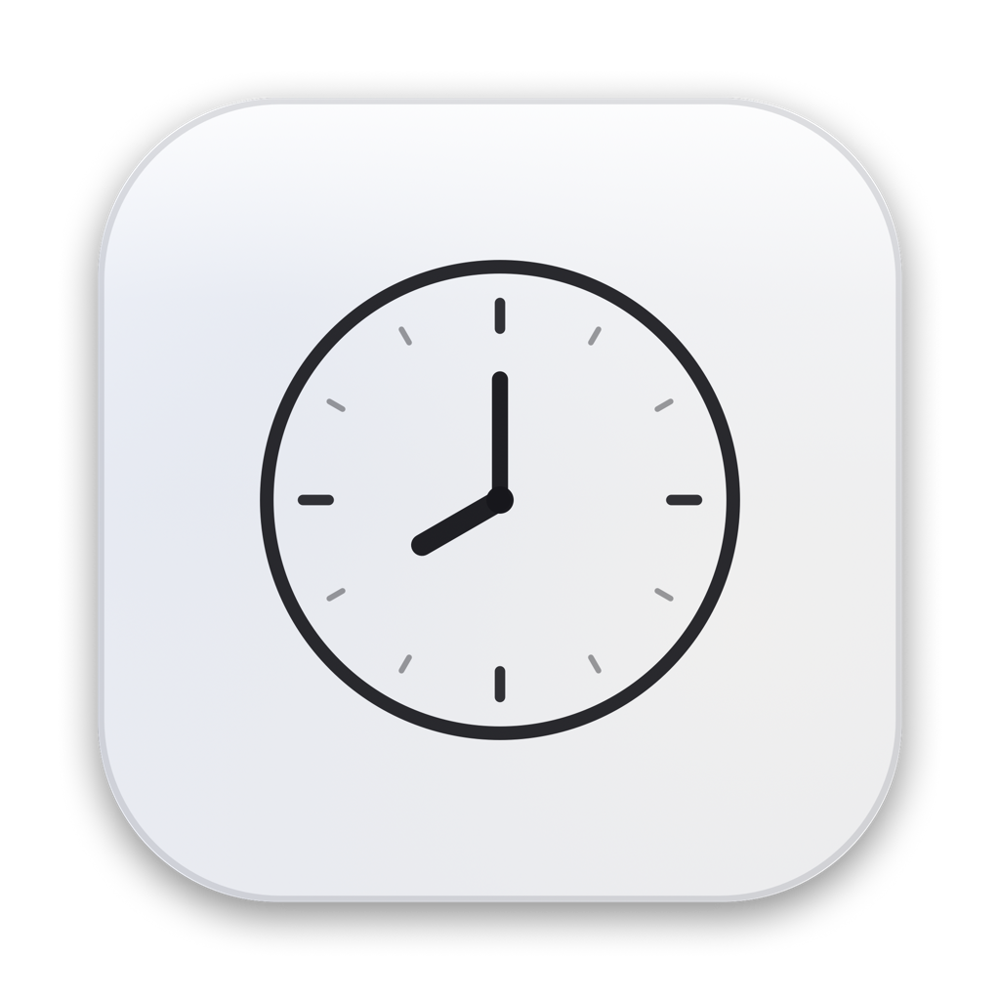

# 全屏闹钟

到点**铺满整个屏幕**，但**不发出任何声音**的 macOS 闹钟。



## 它解决什么问题

- 手机闹钟会**响**，在会议室里响一次就很难解释
- 系统通知**瞟一眼就划走**了，根本拦不住你
- 计时器 App 弹个小窗，你正在专注时根本注意不到

所以做了一个只会"堵住屏幕"的闹钟：**不出声，但让你没法忽略**。

适用场景：会议结束提醒、久坐提醒、专注时段结束、番茄钟、任何需要"物理打断"的时刻。

## 特性

- **占满所有屏幕** — 多显示器每个屏都会盖上，也能盖住全屏应用和所有桌面空间
- **绝对静音** — 代码里没有任何音频相关调用，物理上发不出声音
- **不弹系统通知** — 不走通知中心，不会被专注模式吞掉
- **锁屏不丢** — 锁屏时到点会排在解锁后立即补上
- **睡眠补偿** — 合盖睡过去，唤醒后 30 分钟内的闹钟会补触发
- **多条闹钟** — 列表管理，可单独开关
- **原生 Swift** — 1.5 MB，没有 Electron，没有第三方依赖

| 主窗口 | 图标 |
|---|---|
|  |  |

## 安装

**系统要求：macOS 13 或更高**（Apple 芯片 / Intel 均可）

### 方式一：下载安装

1. 去 [Releases](https://github.com/oxenoxo/fullscreen-alarm/releases) 下载最新的 `ScreenAlarm-x.x.x-macOS.zip`
2. 解压，在终端里运行一次：

```bash
bash install.sh
```

3. 如果双击打开时被系统拦住（提示"无法验证开发者"），右键点图标 → 打开 → 再点一次"打开"

> `install.sh` 做的事情就是：复制到 `/Applications` → 解除系统隔离标记 → 重新签名 → 启动。

### 方式二：自己编译

```bash
git clone https://github.com/oxenoxo/fullscreen-alarm.git
cd fullscreen-alarm
./build.sh
open build/ScreenAlarm.app
```

需要安装 Xcode Command Line Tools（`xcode-select --install`）。编译产物是 Universal，同时支持 Intel 和 Apple 芯片。

## 使用

1. 打开后点右上角 **+**，输入 `07:30` 或 `730`
2. 右侧开关可以单独停用某条闹钟
3. 点任意一行可以编辑或删除
4. 到点后所有屏幕被铺满，按 **ESC** 或点任意位置关闭

**关掉窗口不会退出程序**，闹钟照常触发。要彻底退出按 `Cmd+Q`。

> 首次使用建议在菜单栏 ⏰ 图标里打开「开机自动启动」，否则重启电脑后闹钟就不生效了。

## 常见问题

**Q：到点没反应？**
检查：闹钟开关是不是绿的、程序是不是还在运行（Dock 里要有图标）、当时电脑是不是睡眠了。睡眠错过超过 30 分钟就不会补了。

**Q：能同时设很多个吗？**
可以，列表能滚动，没有数量限制。

**Q：会消耗很多电吗？**
每秒只做一次时间比对，几乎不占资源。

**Q：支持重复规则吗？**
目前是每天重复。工作日/单次之类的规则还没做。

**Q：怎么卸载？**

```bash
osascript -e 'tell application "ScreenAlarm" to quit'
rm -rf /Applications/ScreenAlarm.app
defaults delete com.oxo.screenalarm
```

## 实现要点

几个不太显然的地方，供参考：

- **怎么盖住全屏应用**：窗口层级设为 `CGShieldingWindowLevel()`（远高于菜单栏和普通窗口），配合 `collectionBehavior = [.canJoinAllSpaces, .stationary, .fullScreenAuxiliary, .ignoresCycle]`，让它出现在所有 Space 上。
- **怎么保证不响**：不引入 `AVFoundation`，不用 `NSSound`，不发 `UNUserNotification`。没有代码路径能出声。
- **变色玻璃**：底层 `NSVisualEffectView(.fullScreenUI)` 采样并模糊真实桌面，上面叠 90% 白层，得到干净的白玻璃而不是死白。
- **错过的闹钟**：`tick` 按「闹钟 ID + 日期」去重，唤醒事件里回溯 30 分钟补触发。

源码就两个文件：`Sources/main.swift`（全屏遮罩 + 主逻辑）、`Sources/Panel.swift`（窗口界面）。

## License

[MIT](LICENSE)
